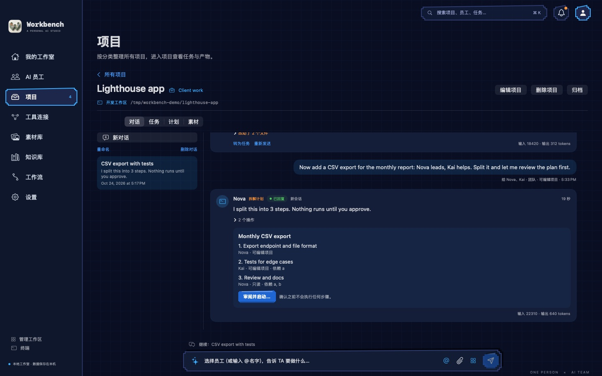
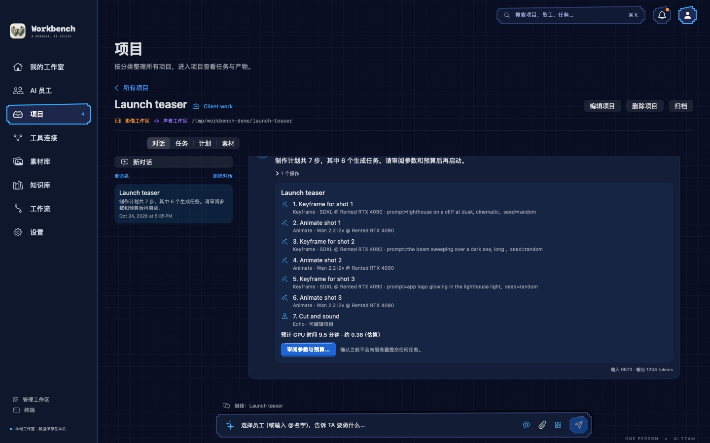

# Workbench

**Your one-person AI studio for macOS.** Workbench brings your AI tools into one native Mac app. Bring Codex, Claude Code or any command-line agent, give each one a role, and run code, video, audio and design work from a single studio on your own machine.

[**Download v1.0.0**](https://github.com/haiyangdeng/My-Workbench/releases/download/v1.0.0/Workbench-1.0.0.dmg) · [Homepage](https://haiyangdeng.github.io/My-Workbench/) · [Releases](https://github.com/haiyangdeng/My-Workbench/releases) · [MIT License](LICENSE)


## Features

**AI employees, on the CLIs you already use.**

- Nothing is built in. You add any command-line agent by hand: its executable, argument templates, output format (plain text, Claude Code's stream-json or Codex's JSONL), access flags, login check, environment variables and proxy.
- Each “AI employee” uses one CLI and has a role, instructions, a default model and a maximum access level (Read-only or Edit in project).
- [Example definitions](docs/cli-examples/README.md) for Claude Code and Codex are ready to import.

**Chat inside projects.**

- Replies stream in, tool activity is listed, and every turn continues the agent's own session.
- You can queue, stop or retry any turn, or continue the same session in the built-in terminal.
- Edit turns in a git project list the changed files with a diff.
- Signed-out CLIs and usage limits are explained in plain language.

**Team mode.**

- Pick two or more agents. The lead splits the work into a plan, which you edit and approve; nothing runs before that.
- Steps run in dependency order, one writer per folder, optionally in their own git worktrees.
- A reviewer agent checks each step against its acceptance criteria, with the diff as evidence. Parallel mode asks several agents the same question side by side, read-only.

**Media studio.**

- **Servers:** connect ComfyUI on your own GPU, local or rented. SSH by key or by a password kept in the Keychain, start and stop commands, a step-by-step connection test, and tunnels that open and reconnect on their own ([guide](docs/GPU_SERVERS.md)).
- **Templates:** import API-format workflows and choose which inputs can be changed.
- **Director mode:** a director agent turns a brief into a production plan with estimates and a budget cap, then reviews the results.
- **Results:** compare images, scrub through videos and play audio with a waveform.

**Projects and categories.** All projects are grouped by category, with filters by category, workspace and status. A cross-project asset library, a knowledge base, and ⌘K search over everything.

**Three looks.** Ink (the default dark look), Pixel (arcade night, shown above) and Paper (light).

**Local-first.**

- No account and no telemetry.
- Projects, conversations and runs are stored in a local SQLite database.
- Tokens, SSH passwords and secret variables go to the macOS Keychain.
- Each CLI runs with its own sign-in on your Mac.

| Team plan | Director's production plan |
| --- | --- |
|  |  |

## Install

1. Download [Workbench-1.0.0.dmg](https://github.com/haiyangdeng/My-Workbench/releases/download/v1.0.0/Workbench-1.0.0.dmg), open it and drag **Workbench** to **Applications**.
2. The first launch is blocked, because this build is signed ad hoc and not notarized by Apple. Open **System Settings → Privacy & Security** and click **Open Anyway**, or run once:

   ```bash
   xattr -dr com.apple.quarantine /Applications/Workbench.app
   ```

3. In **工具连接**, add the CLI you use (for example Codex or Claude Code) and check its login. Then add an AI employee and start a conversation from the input bar.

**Requirements**

- macOS 14 Sonoma or later, on Apple Silicon or Intel (the app is universal).
- At least one CLI agent you can sign in to.
- ComfyUI is optional, for the media workspaces.
- The interface is in Simplified Chinese.

Your data is stored in `~/Library/Application Support/MyWorkbench/`: `workspace.sqlite` holds the workspace, and `Archives/` holds logs and outputs. Upgrades back up the database first.

## Build from source

You need Xcode 26 with the macOS 26 SDK. SwiftPM fetches the one dependency, [SwiftTerm](https://github.com/migueldeicaza/SwiftTerm), on the first build.

```bash
zsh scripts/build.sh
```

The script runs the unit tests and builds `.build/xcode/Build/Products/Debug/Workbench.app`. You can also open `MyWorkbench.xcodeproj` and run the **MyWorkbench** scheme. Set `DEVELOPER_DIR` if Xcode is not in `/Applications`.

The Xcode project is generated. After adding Swift files, run `python3 scripts/create_xcode_project.py`.

To build the installer:

```bash
zsh scripts/make_dmg.sh
```

It builds the universal app (x86_64 + arm64, ad hoc signed) and writes `Workbench-<version>.dmg`, a zip of the app and SHA-256 checksums to `releases/`.

## Tests and checks

| Command | What it covers |
| --- | --- |
| `swift test` | 111 unit tests for the core: CLI definitions and output parsing, process control, git, budgets, servers, persistence |
| `zsh scripts/verify_m5.sh` … `verify_m9.sh`, `verify_crud.sh` | The real app store and views, driven with stand-in CLIs and a stand-in ComfyUI server |
| `zsh scripts/verify_servers.sh` | On-demand GPU servers with a stand-in `ssh`. Add `--real-codex` for a Codex-directed image (calls the model) |
| `zsh scripts/verify_real_codex.sh` | About 20 real Codex turns covering chat, edits, stop, restart, team plans, reviews and director mode (needs a signed-in Codex and uses its quota) |
| `python3 -I scripts/verify_cli_flags.py` | Checks every flag in the example CLI definitions against the installed CLIs' help, without calling a model |
| `zsh scripts/render_theme_preview.sh` | Offscreen renders of the three looks |

The results of the 1.0 test pass are in [docs/TEST_REPORT_2026-10-24.md](docs/TEST_REPORT_2026-10-24.md) and [docs/VALIDATION.md](docs/VALIDATION.md).

## Project layout

| Path | Contents |
| --- | --- |
| `Sources/WorkbenchCore` | Models, persistence (SQLite), the CLI runner and output parsers, git, the ComfyUI client, SSH settings |
| `Sources/WorkbenchApp` | The SwiftUI app: store, views, styles, terminal |
| `Tests/WorkbenchCoreTests` | Unit tests |
| `scripts` | Build, packaging, verification and render scripts, plus fixtures (stand-in CLIs, ComfyUI and ssh) |
| `docs` | [PRD v0.6](docs/PRD_V06.md), [GPU servers](docs/GPU_SERVERS.md), [CLI examples](docs/cli-examples/README.md), [design notes](docs/design), test reports |
| `site` | The [homepage](https://haiyangdeng.github.io/My-Workbench/), published with GitHub Pages |

## License

Workbench is released under the [MIT License](LICENSE).

[SwiftTerm](https://github.com/migueldeicaza/SwiftTerm) is also MIT-licensed; its notice is in [docs/third-party/SwiftTerm-LICENSE.txt](docs/third-party/SwiftTerm-LICENSE.txt). The homepage uses the Press Start 2P and VT323 fonts from Google Fonts (SIL Open Font License).
